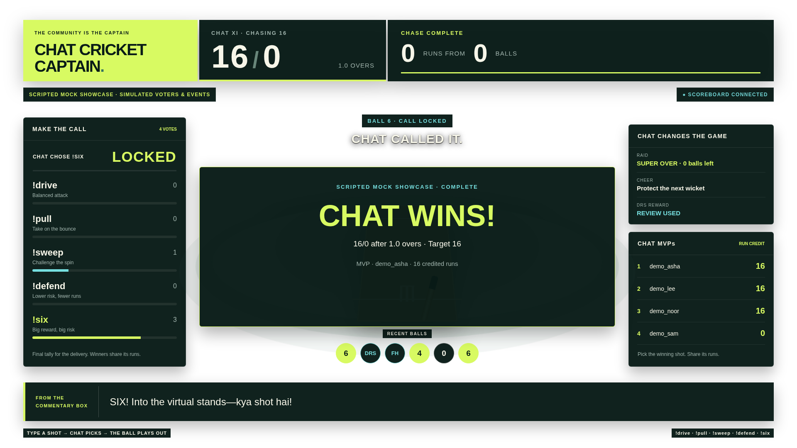

# Chat Cricket Captain

**One chat. One chase. Every call counts.** A Twitch community becomes one cricket batter: viewers vote for a shot, the winning call faces the bowler, and everyone who picked it shares the run credit. A raid triggers a Super Over, a cheer protects the next ball, and a DRS reward can reverse a wicket. Built with OpenAI Codex.

Designed for a stream break or a community challenge, with an OBS browser overlay and a local control room. No cricket knowledge, paid API, or Twitch credentials are needed to try it.



*Captured from the local scripted fixture. Names, events, and random rolls are simulated; the game calculates the displayed scores.*

## Try the last-ball thriller

Requires **Node.js 20+**.

```bash
npm install
npm start
```

1. Open **[localhost:3000/mock](http://localhost:3000/mock)**. The control room includes a live overlay preview.
2. Click **Play the showcase**. Watch the raid, opening six, DRS reversal, Free Hit save, and final-ball winning shot.
3. Click **Reset to manual play**, enter a name, and send `!drive`, `!pull`, `!sweep`, `!defend`, or `!six`. Open another browser window to see the same match update.
4. Use **Raid**, **Cheer**, and **Redeem DRS** to test event effects. DRS becomes available after a wicket. The control room explains rejected actions; shot buttons pause while a delivery resolves.

The showcase is an **explicitly scripted mock fixture**, with `demo_` voters and authored random rolls. Its target of 16 from six balls is a rehearsal setting, not an audience or performance claim. Every run, vote, wicket, review, and MVP credit still comes from the real game engine. It lasts about a minute; replay and reset cancel the old timers. Manual input is disabled during the rehearsal and returns after reset.

Without credentials the app starts in mock mode. To force that mode when credentials are already configured:

```bash
MOCK_MODE=1 npm start
```

The scripted showcase is unavailable when Twitch is configured, and it never sends its rehearsal announcements to Twitch. Manual control-room event buttons always simulate events; they do not create actual cheers, raids, or redemptions on Twitch.

## What chat controls

| Input | Effect |
|---|---|
| `!drive` / `!pull` / `!sweep` / `!defend` / `!six` | One vote per person per ball; the latest valid shot replaces the earlier vote. Most votes win; ties use the random generator. With no votes, chat defends. |
| Cheer / bits | Arms a Free Hit for the next delivery; a would-be wicket becomes a dot ball. A second cheer while armed does not stack another Free Hit. |
| Raid | Once per innings, changes the remaining chase to six balls. Target and score stay intact. |
| Custom reward titled `DRS` | One review per innings, with a 50/50 chance of overturning the most recent wicket. It does not refund the ball. A successful all-out review resumes play if deliveries remain. |

Six balls make an over. Reach the target before running out of deliveries or wickets. The normal match defaults to **36 runs from three overs**. Each voter whose shot won receives that delivery’s runs as personal MVP credit; this does not multiply the team score. Different shots have different outcome distributions against the bowler’s delivery. `!defend` has lower wicket risk, while `!six` has greater boundary potential and risk.

## OBS setup

1. Start the app, then add a **Browser Source** in OBS.
2. URL: **`http://localhost:3000/overlay`**.
3. Width: **1920**. Height: **1080**. FPS: **60**.
4. Place the source above your stream scene. The overlay background is transparent; the control room’s preview backdrop is separate.
5. Keep the source active if you want to see every reveal. Reloading or reconnecting restores the score, recent balls, powers, and MVPs; it does not replay old animations.

The overlay scales proportionally in smaller browser windows. It uses system fonts and CSS artwork, with no remote fonts, images, audio, or build step. Reduced-motion settings disable delivery movement. A connection indicator marks stale state while reconnecting, and the final delivery reveals before the match result card.

The server binds to `127.0.0.1` by default. The control room can reset the match and is intended for the operator’s local machine. If you deliberately expose it elsewhere, put authentication and HTTPS in front of it; WebSockets use `wss://` on HTTPS pages. This project does not include public hosting or multi-channel isolation.

## Configuration

See [.env.example](.env.example). Settings come from the environment; `npm start` does **not** automatically load `.env`. Export values in your shell, or use Node's environment-file support with your private `.env`:

```bash
node --env-file=.env server.js
```

| Variable | Default | Purpose |
|---|---|---|
| `PORT` | `3000` | Local HTTP/WebSocket port |
| `HOST` | `127.0.0.1` | Listening interface |
| `VOTE_WINDOW_MS` | `15000` | Manual/Twitch voting window in milliseconds |
| `TARGET` | `36` | Runs needed to win a normal chase |
| `MAX_OVERS` | `3` | Normal innings length in overs |
| `MOCK_MODE` | `0` | Set to `1` to force credential-free rehearsal |

Use positive integers for vote duration, target, and overs. Showcase settings are fixed separately for reproducibility.

### Optional Twitch chat

IRC chat activates when all of these are set and `MOCK_MODE` is not `1`:

- `TWITCH_CHANNEL`: channel login, without `#`.
- `TWITCH_BOT_USERNAME`: the account sending result announcements.
- `TWITCH_OAUTH_TOKEN`: that bot account’s user OAuth token, conventionally prefixed with `oauth:`; requires `chat:read` and `chat:edit`.

Create an application in the [Twitch Developer Console](https://dev.twitch.tv/console) and obtain user tokens through Twitch OAuth. Never commit tokens; `.env` is ignored. Chat is connected through `tmi.js`; the app announces deliveries and innings results.

### Optional Twitch EventSub

With chat configured, also provide `TWITCH_CLIENT_ID` and `TWITCH_USER_OAUTH_TOKEN`. The latter must be a **user access token**, not an app token. For the existing subscription setup, use the broadcaster’s user token with:

- `channel:read:redemptions` for the custom reward named **DRS**.
- `bits:read` for cheers.
- `moderator:read:followers` for the follow subscription (follows currently have no game effect).

Raids require no extra scope. The app looks up the broadcaster from `TWITCH_CHANNEL`; `TWITCH_BROADCASTER_ID` can skip the lookup. `TWITCH_MODERATOR_ID` defaults to the broadcaster. The EventSub WebSocket requires no public callback URL. IRC cheer/raid handlers provide a fallback; an already-armed Free Hit and an already-active Super Over ignore repeat triggers.

**Live Twitch OAuth, EventSub lifecycle behavior, and OBS capture were not verified in this session because no live credentials were available.** Local tests exercise event payload routing and the same game mechanics. Real Twitch footage is still required for the Devpost submission; mock footage alone is insufficient. See [DEMO.md](DEMO.md).

## Verification and troubleshooting

```bash
npm test
```

The suite covers vote replacement, scoring, the probability engine, chase endings, DRS success/failure/resumption, Free Hits, raid/reset behavior, deterministic showcase playback, timer cancellation, presentation rules, HTTP actions, WebSocket reconnect state, and Twitch event fixtures. It runs locally without credentials or network API calls.

For an optional real Chrome smoke check:

```bash
npm run test:browser
# If Chrome is not on PATH:
CHROME_BIN=/path/to/chrome npm run test:browser
```

This checks desktop/mobile controls, literal rendering of user names, the showcase’s review and final reveal, page reload, transparent background, and smaller overlay sizes. It writes screenshots to a temporary directory printed at completion. Chrome is optional and is not installed by `npm install`.

- **Cannot start / port already used:** stop the other process or run `PORT=3001 npm start`, then use that port in your browser and OBS.
- **Disconnected indicator:** check the server is still running. The pages reconnect automatically.
- **Voting closed:** wait for the next delivery window or reset a finished match.
- **DRS unavailable:** a wicket must exist and the innings’ review must be unused. A successful final-ball review cannot add deliveries.
- **Showcase button disabled:** wait for the local connection, or restart with `MOCK_MODE=1` if Twitch is configured.
- **Refresh did not reset:** match state belongs to the server. Use **Reset to manual play**; restarting the server clears in-memory state too.

## Built with Codex

The human brief in [SPEC.md](SPEC.md) defined the cricket experience, Twitch interactions, and dependency constraints. The original Codex session implemented the engine, commentary, HTTP/WebSocket server, Twitch adapters, overlay, and initial tests. Its recorded thread ID is **`01a17995-b816-76d3-9463-0d48a4971357`**.

Follow-up **Codex (gpt-6-astra)** work maps the judging rules to [WINPLAN.md](WINPLAN.md), implements the reproducible showcase and operator workflow, and verifies the broadcast redesign. Codex separated scheduling into a testable controller, repaired stalled play after DRS, validated configuration, and added regression/integration tests. Browser inspection caught a fallback-font overflow that obscured the mock label; the typography now fits without external fonts. The local test suite and Chrome smoke check validate the resulting experience. [SESSIONS.md](SESSIONS.md) records the actual thread IDs and contributions; unavailable token usage stays unreported.

Codex is the **development tool** here. The running game uses template commentary and an outcome matrix; it does not call an LLM or need an OpenAI API key. Show the actual Codex thread and test output in the build portion of the submission video, rather than implying AI runs the match.

| Source | Responsibility |
|---|---|
| `src/game.js` | Timer-free vote, probability, score, event, and MVP engine; injectable RNG and clock |
| `src/match.js` | Match timers, event broadcasts, reset, DRS resumption, and showcase orchestration |
| `src/showcase.js` | Clearly identified rehearsal shots, cues, and random rolls |
| `server.js` | Importable HTTP/WebSocket app with explicit startup/shutdown |
| `src/twitch.js` | Optional IRC/EventSub adapters |
| `src/commentary.js` | Deterministic English-first commentary with Hinglish flavor |
| `public/` | Local overlay/control assets and shared presentation rules |

## Submission materials

[WINPLAN.md](WINPLAN.md) maps every judging criterion and submission gate to evidence and remaining work. [DEMO.md](DEMO.md) provides the recording script and live-Twitch proof checklist. No public repository URL, video URL, audience metrics, or contest outcomes are claimed here.

## License

MIT © 2026 Kulraj Singh Sabharwal. See [LICENSE](LICENSE).
