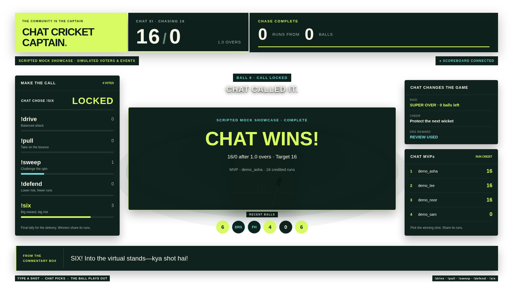

# Chat Cricket Captain

**One chat. One chase. Every call counts.** A Twitch community becomes one cricket batter: viewers vote for a shot, the winning call faces the bowler, and everyone who picked it gets that delivery's run credit. A raid opens a Super Over, a cheer protects the next ball, and a DRS reward can reverse a wicket.

Built for a stream break or a community challenge, with an OBS browser overlay and a local control room. No cricket knowledge, paid API, or Twitch credentials are needed to try it.



*Captured from the local scripted fixture. Names, events, and random rolls are simulated; the game calculates the displayed scores.*

## Try the last-ball thriller

Requires **Node.js 20+**.

```bash
npm install
npm start
```

1. Open **[localhost:3000/mock](http://localhost:3000/mock)**. The control room includes a live overlay preview.
2. Click **Play the showcase**. Watch the raid, opening six, DRS reversal, Free Hit save, and final-ball winning shot.
3. Click **Reset to manual play**, enter a name, and send `!drive`, `!pull`, `!sweep`, `!defend`, or `!six`. Open another browser window to see the same match update.
4. Use **Raid**, **Cheer**, and **Redeem DRS** to test event effects. DRS becomes available after a wicket.

The showcase is an explicitly scripted mock fixture with `demo_` voters and authored random rolls; its target of 16 from six balls is a rehearsal setting, not a performance claim. Every run, vote, wicket, review, and MVP credit still comes from the real game engine. It lasts about a minute; replay and reset cancel the old timers. Without credentials the app starts in mock mode already — force it with `MOCK_MODE=1 npm start`.

## What chat controls

| Input | Effect |
|---|---|
| `!drive` / `!pull` / `!sweep` / `!defend` / `!six` | One vote per person per ball; the latest valid shot replaces the earlier vote. Most votes win; ties use the random generator. With no votes, chat defends. |
| Cheer / bits | Arms a Free Hit for the next delivery; a would-be wicket becomes a dot ball. A second cheer while armed does not stack. |
| Raid | Once per innings, changes the remaining chase to six balls. Target and score stay intact. |
| Custom reward titled `DRS` | One review per innings, 50/50 to overturn the most recent wicket. It does not refund the ball. A successful all-out review resumes play if deliveries remain. |

Six balls make an over. Reach the target before running out of deliveries or wickets. The normal match defaults to **36 runs from three overs**. Each voter whose shot won receives that delivery's runs as personal MVP credit; this does not multiply the team score.

## OBS setup

1. Start the app, then add a **Browser Source** in OBS.
2. URL `http://localhost:3000/overlay`, size **1920×1080**, **60** FPS.
3. Place the source above your stream scene. The overlay background is transparent; the control room's preview backdrop is separate.
4. Keep the source active to see every reveal. Reloading or reconnecting restores score, recent balls, powers, and MVPs without replaying old animations.

The overlay scales proportionally in smaller windows and uses system fonts and CSS artwork, with no remote fonts, images, audio, or build step. Reduced-motion settings disable delivery movement. The server binds to `127.0.0.1` by default and the control room is meant for the operator's own machine. This project does not include public hosting or multi-channel isolation.

## Configuration

See [.env.example](.env.example). Settings come from the environment; `npm start` does **not** load `.env` automatically. Export values in your shell, or use Node's environment-file support:

```bash
node --env-file=.env server.js
```

| Variable | Default | Purpose |
|---|---|---|
| `PORT` | `3000` | Local HTTP/WebSocket port |
| `HOST` | `127.0.0.1` | Listening interface |
| `VOTE_WINDOW_MS` | `15000` | Manual/Twitch voting window in milliseconds |
| `TARGET` | `36` | Runs needed to win a normal chase |
| `MAX_OVERS` | `3` | Normal innings length in overs |
| `MOCK_MODE` | `0` | Set to `1` to force credential-free rehearsal |

Use positive integers for vote duration, target, and overs. Showcase settings are fixed separately for reproducibility.

### Optional Twitch chat and EventSub

IRC chat activates when `TWITCH_CHANNEL`, `TWITCH_BOT_USERNAME`, and `TWITCH_OAUTH_TOKEN` are set and `MOCK_MODE` is not `1`. Create an application in the [Twitch Developer Console](https://dev.twitch.tv/console); the bot token needs `chat:read` and `chat:edit`. The app announces deliveries and innings results through `tmi.js`.

For cheers and raids over EventSub, also provide `TWITCH_CLIENT_ID` and a **user** access token in `TWITCH_USER_OAUTH_TOKEN`, with `channel:read:redemptions` (the custom reward named **DRS**), `bits:read`, and `moderator:read:followers`. Raids need no extra scope. The app looks up the broadcaster from `TWITCH_CHANNEL`; `TWITCH_BROADCASTER_ID` skips the lookup. No public callback URL is required. At chat startup the app picks one source for cheers and raids — EventSub when fully configured, otherwise IRC — and never silently falls back. IRC still carries votes and announcements in either mode. Restarting resets the match and clears the notification cache.

Never commit tokens; `.env` is ignored. EventSub delivery is [at least once](https://dev.twitch.tv/docs/eventsub/#handling-duplicate-events): the adapter remembers up to 4,096 notification IDs for ten minutes from first receipt, across handoffs, reconnects, and match resets, so a repeated ID cannot apply a second power. Expiry, capacity eviction, or a restart removes that protection.

## Verification and troubleshooting

```bash
npm test
```

The suite covers vote replacement, scoring, the probability engine, chase endings, DRS success/failure/resumption, Free Hits, raid/reset behavior, deterministic showcase playback, timer cancellation, presentation rules, HTTP actions, WebSocket reconnect state, and Twitch event fixtures. It runs locally without credentials or network calls.

For an optional real-Chrome smoke check (Chrome is not installed by `npm install`):

```bash
npm run test:browser
# If Chrome is not on PATH:
CHROME_BIN=/path/to/chrome npm run test:browser
```

- **Cannot start / port already used:** stop the other process or run `PORT=3001 npm start`.
- **Disconnected indicator:** check the server is still running; pages reconnect automatically.
- **Voting closed:** wait for the next window or reset a finished match.
- **DRS unavailable:** a wicket must exist and the innings' review must be unused.
- **Showcase button disabled:** wait for the local connection, or restart with `MOCK_MODE=1`.
- **Refresh did not reset:** match state lives on the server; use **Reset to manual play**.

## Built with Codex

The brief in [SPEC.md](SPEC.md) defines the cricket experience, Twitch interactions, and dependency constraints. [SESSIONS.md](SESSIONS.md) attributes the original engine, commentary, server, Twitch adapters, overlay, and initial tests to recorded Codex thread **`01a17995-b816-76d3-9463-0d48a4971357`**. **This handoff has not authenticated that record against the original conversation — confirm the thread and its contents before submitting it as build evidence.** Later Hermes regression work is not a Codex session. Historical token counts are not verified and are not submission evidence.

Codex is the development tool here. The running game uses template commentary and an outcome matrix; it does not call an LLM or need an OpenAI API key. Show the actual Codex thread and test output in the build portion of the video rather than implying AI runs the match.

| Source | Responsibility |
|---|---|
| `src/game.js` | Timer-free vote, probability, score, event, and MVP engine; injectable RNG and clock |
| `src/match.js` | Match timers, event broadcasts, reset, DRS resumption, and showcase orchestration |
| `src/showcase.js` | Clearly identified rehearsal shots, cues, and random rolls |
| `server.js` | Importable HTTP/WebSocket app with explicit startup/shutdown |
| `src/twitch.js` | Optional IRC/EventSub adapters |
| `src/commentary.js` | Deterministic English-first commentary with Hinglish flavor |
| `public/` | Local overlay/control assets and shared presentation rules |

## Submission materials and honest limits

The [local evidence index](docs/local-evidence.md) separates current checks from earlier recordings. [WINPLAN.md](WINPLAN.md) maps every judging criterion and submission gate to evidence and remaining work; [DEMO.md](DEMO.md) has the recording script and the live-Twitch proof checklist.

Known gaps, none of them hidden:

- **Live Twitch OAuth, EventSub behavior, and OBS capture are unverified.** Local tests cover adapters, fixtures, localhost sockets, handoffs, and shutdown, but not live permissions, token expiry, or delivery reliability. Real Twitch footage is required for the Devpost submission; mock footage alone is insufficient.
- **Local actions are not authenticated.** HTTP actions require `Content-Type: application/json`, and HTTP/WebSocket browser Origins must match the host (same-host HTTPS is accepted for a reverse proxy that preserves `Host`). These are not authentication, DNS-rebinding protection, or a public-hosting boundary. `PUBLIC_READONLY=1` disables HTTP control actions and the control-room page but still exposes match state, including viewer names, to overlay clients.
- **No public repository URL, video URL, audience metrics, or contest outcomes are claimed.**

All clips in `demo/` are actual scripted rehearsals with a permanent mock/no-live-Twitch-or-OBS disclosure, not complete contest videos. Reproduce the gameplay with the steps at the top of this README; use `npm test` and the optional Chrome command above to check the implementation.

## License

MIT © 2026 Kulraj Singh Sabharwal. See [LICENSE](LICENSE).